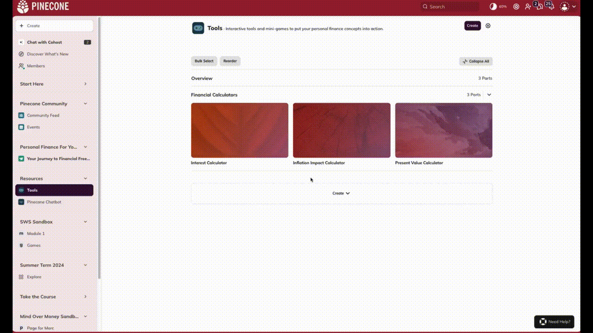

# Instructions for deployment and embedding

## Overview

Code goes from a feature branch to `dev`, then staging QA, then `1.x`, then production. Each deploy command only runs from its own branch (`scripts/check-branch.js`).

| Environment | Branch | Command | URL |
|---|---|---|---|
| Staging | `dev` | `yarn deploy:staging` | https://su-sws.github.io/ifdm_learning_apps_staging/ |
| Production | `1.x` | `yarn deploy` | https://ifdm-learning.stanford.edu/ |

```
feature/my-branch  →  PR  →  dev  →  yarn deploy:staging  →  QA on staging
                                                                     ↓ approved
                       CHANGELOG  →  PR to 1.x  →  yarn deploy  →  production
```

---

## Prerequisites

- Node v22.16.0 via `nvm use` (reads `.nvmrc`) and yarn 1.22.22
- Push access to `SU-SWS/ifdm_learning_apps` (prod) and `SU-SWS/ifdm_learning_apps_staging` (staging), with SSH set up for GitHub
- A clean working tree, since the deploy builds whatever is checked out

---

## Release to staging

1. Merge the feature-branch PR into `dev`.
2. Switch to the latest `dev`:
   ```
   git checkout dev && git fetch && git pull
   ```
3. Confirm the correct Node version is active:
   ```
   nvm use
   ```
4. Deploy:
   ```
   yarn deploy:staging
   ```
   This builds with `basePath=/ifdm_learning_apps_staging` and pushes `out/` to the staging repo's `gh-pages` branch.
5. Check https://github.com/SU-SWS/ifdm_learning_apps_staging/deployments, then QA at https://su-sws.github.io/ifdm_learning_apps_staging/

---

## Release to production

1. After staging QA passes, write the release notes. On `dev`, add a new top section to `CHANGELOG.md` with the version and deploy date, for example `## [1.3.6] - YYYY-MM-DD`. List changes under Added / Changed / Fixed, and give each one its ticket and PR number (e.g. `(IFDM-388, #223)`). Commit it to `dev`.
2. Open a PR from `dev` into `1.x` and merge it. Add the release PR link to the changelog entry: `Release PR [#NNN](…) (dev into 1.x).`
3. Switch to the latest `1.x`:
   ```
   git checkout 1.x && git fetch && git pull
   ```
4. Confirm the correct Node version is active:
   ```
   nvm use
   ```
5. Deploy:
   ```
   yarn deploy
   ```
   `predeploy` checks the branch, builds, and copies `CNAME` into `out/`. Then `gh-pages` pushes `out/` to `gh-pages`.
6. Check https://github.com/SU-SWS/ifdm_learning_apps/deployments, then spot-check https://ifdm-learning.stanford.edu/
7. Check the embedded calculators on the [IFDM Resource Hub](https://ifdm.stanford.edu/resourcehub/calculators). Each should load and show the release's changes.

---

## One-time staging setup (already done — for reference)

If the staging environment ever needs to be rebuilt from scratch:

1. Create a new GitHub repo: `SU-SWS/ifdm_learning_apps_staging`
2. In that repo's Settings → Pages, set the source to the `gh-pages` branch
3. Add the staging remote to your local clone:
   ```
   git remote add staging git@github.com:SU-SWS/ifdm_learning_apps_staging.git
   ```
   Note: `yarn deploy:staging` targets this remote directly via `gh-pages -r`; the local remote entry is for reference and manual pushes only.

---

## Embedding a calculator

Example iFrame:

```html
<iframe src="https://ifdm-learning.stanford.edu/interactives/investment-calculator/"></iframe>
```

See below screencast as an example of embedding the iframe:



---

## Troubleshooting

| Symptom | Fix |
|---|---|
| `Deploy blocked: must be on branch …` | Check out the right branch: `dev` for staging, `1.x` for prod. |
| Staging 404s on `/_next/` assets | Deploy with `yarn deploy:staging`, which runs `build:staging` and sets the basePath. A plain `build` won't work for staging. |
| Prod custom domain broken | Make sure `out/CNAME` exists. Only `yarn build` (via `yarn deploy`) copies it there. |
| Changes not showing | Hard-refresh or clear cache, check the repo's Deployments tab, and confirm `gh-pages` has a new commit. |

### iframe issues
- Ensure the source URL is correct
- Check for CORS restrictions
- Test the iframe URL directly in browser
